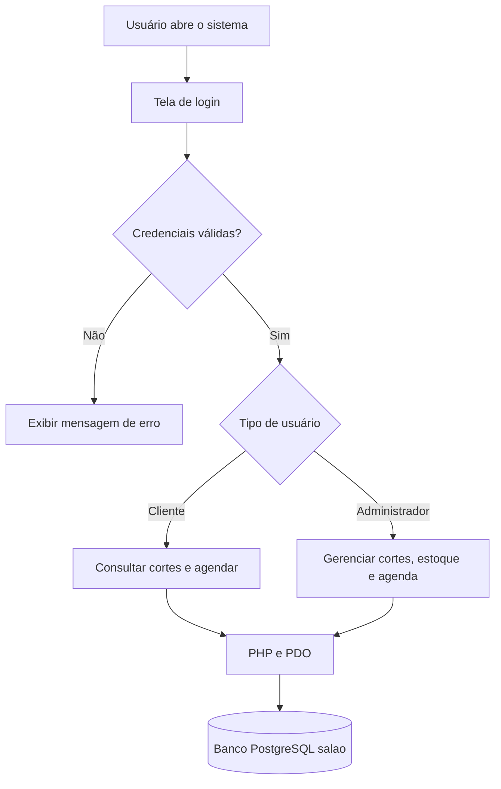

# Sistema de Cabeleireiro — Documentação Técnica e Restauração do Banco de Dados

## Sumário

1. Visão geral do projeto
2. Requisitos funcionais
3. Regras de negócio e segurança
4. Arquitetura e funcionamento
5. Estrutura do banco de dados
6. Instalação e execução do sistema
7. Processo de geração do dump
8. Processo de restauração do banco
9. Verificação após a restauração
10. Testes funcionais
11. Possíveis erros e soluções
12. Segurança e recomendações
13. Registro de evidências

---

## 1. Visão geral do projeto

### 1.1 Objetivo

O Sistema de Cabeleireiro é uma aplicação web desenvolvida para facilitar o gerenciamento de um salão de cabeleireiro. O sistema permite que clientes consultem cortes disponíveis e realizem agendamentos, enquanto o administrador gerencia os cortes, os produtos do estoque e os atendimentos.

Além das funcionalidades do sistema, esta documentação descreve como verificar o banco de dados PostgreSQL, gerar uma cópia de segurança (*dump*) e testar sua restauração em um banco separado.

### 1.2 Tecnologias utilizadas

| Tecnologia | Utilização |
|---|---|
| PHP | Processamento das páginas e regras do sistema |
| HTML | Estrutura das páginas |
| CSS | Estilização da interface |
| PostgreSQL | Armazenamento dos dados |
| PDO | Conexão entre PHP e PostgreSQL |
| Apache ou servidor PHP | Execução da aplicação web |
| MobaXterm | Acesso ao terminal do servidor remoto |
| Git e GitHub | Versionamento e armazenamento do código |

### 1.3 Perfis de acesso

**Cliente**
- Criar uma conta e entrar no sistema.
- Consultar os cortes e seus preços.
- Escolher um corte, uma data e um horário.
- Adicionar observações ao agendamento.

**Administrador**
- Cadastrar, editar e excluir cortes.
- Consultar a agenda.
- Marcar atendimentos como feitos.
- Cadastrar produtos e controlar as quantidades do estoque.
- Consultar alertas de estoque baixo.

O cadastro público cria contas de clientes. O administrador é cadastrado separadamente no banco de dados.

### 1.4 Organização do projeto

A pasta principal da aplicação é `mini-sistema`.

```text
mini-sistema/
├── index.php
├── app/
│   ├── agenda.php
│   ├── cortes.php
│   ├── estoque.php
│   ├── marcar_feito.php
│   └── select.php
├── database/
│   ├── connect.php
│   └── salao.sql
├── include/
│   ├── functions.php
│   ├── header.php
│   └── footer.php
├── login/
│   ├── login.php
│   ├── cadastrar.php
│   ├── logout.php
│   └── verifica.php
├── style/
└── imagens/
```

A estrutura acima resume os principais arquivos documentados do projeto. A lista exata deve ser conferida com a versão mais recente do repositório.

---

## 2. Requisitos funcionais

| Código | Requisito | Arquivo principal |
|---|---|---|
| RF01 | Cadastrar conta de cliente | `login/cadastrar.php` |
| RF02 | Realizar login | `login/login.php` |
| RF03 | Encerrar sessão | `login/logout.php` |
| RF04 | Exibir cortes disponíveis e preços | `index.php` |
| RF05 | Cadastrar, editar e excluir cortes | `app/cortes.php` |
| RF06 | Agendar um corte | `app/agenda.php` |
| RF07 | Verificar se o horário já está ocupado | `app/agenda.php` |
| RF08 | Consultar os agendamentos como administrador | `app/agenda.php` |
| RF09 | Marcar atendimento como feito | `app/marcar_feito.php` |
| RF10 | Cadastrar produtos no estoque | `app/estoque.php` |
| RF11 | Registrar entrada e saída de produtos | `app/estoque.php` |
| RF12 | Avisar quando o estoque estiver baixo | `app/estoque.php` |

Esses requisitos descrevem as principais funcionalidades previstas no projeto. Para a entrega, recomenda-se testar cada uma no ambiente em que o sistema será apresentado.

---

## 3. Regras de negócio e segurança

### 3.1 Regras de negócio

- O cadastro público é destinado aos clientes.
- O administrador possui acesso às áreas de gerenciamento.
- Os campos obrigatórios devem ser preenchidos antes de cadastrar os dados.
- O preço do corte deve ser numérico e não negativo.
- O cliente seleciona um corte, uma data e um horário para agendar.
- O sistema verifica se o horário já está ocupado.
- A saída de produtos não deve deixar o estoque com quantidade negativa.
- O administrador pode marcar um atendimento como feito.
- O sistema utiliza sessões para controlar o acesso às páginas internas.

### 3.2 Segurança

O projeto utiliza PHP com PDO para acessar o PostgreSQL. Entre os cuidados importantes estão:

- Utilizar consultas preparadas para enviar dados ao banco.
- Validar os dados recebidos dos formulários no servidor.
- Proteger as páginas administrativas contra acesso de usuários não autorizados.
- Encerrar a sessão quando o usuário sair.
- Evitar expor senhas e credenciais no código publicado no GitHub.
- Fazer cópias de segurança antes de alterações importantes no banco.

---

## 4. Arquitetura e funcionamento

### 4.1 Fluxo geral



### 4.2 Conexão com o banco

O arquivo `database/connect.php` é responsável por configurar a conexão com o PostgreSQL.

O fluxo básico é:

1. O usuário interage com uma página.
2. O PHP valida os dados recebidos.
3. A aplicação acessa o banco utilizando PDO.
4. O PostgreSQL consulta ou modifica os registros.
5. O sistema apresenta o resultado na página.

A conexão depende do endereço do servidor, do nome do banco, do usuário e da senha configurados no ambiente.

---

## 5. Estrutura do banco de dados

### 5.1 Banco utilizado

O banco utilizado pelo projeto é o PostgreSQL, com o nome `salao`.

### 5.2 Tabelas principais

| Tabela | Finalidade |
|---|---|
| `usuarios` | Armazenar as contas dos clientes |
| `administradores` | Armazenar as contas administrativas |
| `cortes` | Armazenar os cortes disponíveis e seus preços |
| `estoque` | Armazenar produtos, fornecedores e quantidades |
| `agendamentos` | Armazenar os horários marcados pelos clientes |

### 5.3 Relacionamentos

A tabela `agendamentos` relaciona o cliente ao corte escolhido:

- `cliente_id` identifica o cliente na tabela `usuarios`.
- `corte_id` identifica o corte na tabela `cortes`.

Esses relacionamentos ajudam a manter a associação entre os agendamentos e os registros correspondentes.

### 5.4 Arquivo SQL

O arquivo `database/salao.sql` contém a estrutura exportada do banco de dados.

**Importante:** a versão documentada do arquivo contém a estrutura das tabelas, sem os registros dos clientes, cortes, produtos e agendamentos. Portanto, restaurar apenas esse arquivo não recupera os registros que existiam no banco original.

Se for necessário transferir os dados existentes, será preciso gerar e proteger também um dump que inclua os registros.

---

## 6. Instalação e execução do sistema

### 6.1 Pré-requisitos

Antes de executar o projeto, verificar se o ambiente possui:

- PHP compatível com o código.
- Extensão `pdo_pgsql` habilitada.
- PostgreSQL instalado e em execução.
- Git, caso o projeto seja baixado do GitHub.
- Apache ou servidor PHP configurado.

No terminal, verificar as versões:

```bash
php -v
```

```bash
psql --version
```

Para conferir a extensão utilizada pelo PHP:

```bash
php -m | grep pdo_pgsql
```

Se a extensão não aparecer, será necessário verificar a instalação e a configuração do PHP.

### 6.2 Baixar o projeto

No ambiente em que o projeto será executado, clonar o repositório:

```bash
git clone https://github.com/KauamDeSouzaBelsi/sistema-de-cabeleleiro.git sistema-de-cabeleireiro
```

Entrar na pasta:

```bash
cd sistema-de-cabeleireiro
```

O nome da pasta deve ser compatível com os caminhos utilizados nos redirecionamentos e nos links do projeto.

### 6.3 Criar o banco

Antes de executar os comandos, verificar se o banco e o usuário já existem. Se ainda não existirem, um administrador do PostgreSQL poderá criá-los.

Exemplo, dentro do terminal do PostgreSQL:

```sql
CREATE USER salao WITH PASSWORD 'SUA_SENHA';
CREATE DATABASE salao OWNER salao;
```

A senha acima é um exemplo: deve ser substituída por uma senha segura e não deve ser publicada no GitHub.

Depois, carregar a estrutura:

```bash
psql -U salao -d salao -f mini-sistema/database/salao.sql
```

A execução depende da configuração de autenticação do PostgreSQL e das permissões do usuário.

### 6.4 Configurar a conexão

Abrir o arquivo:

```text
mini-sistema/database/connect.php
```

Conferir o endereço do servidor, o nome do banco, o usuário e a senha. Os valores devem corresponder ao ambiente em que o banco está instalado.

### 6.5 Iniciar e testar o sistema

Iniciar o servidor web ou o servidor de desenvolvimento PHP conforme o ambiente. Em seguida, abrir a URL correspondente no navegador e verificar se a tela de login aparece.

---

## 7. Processo de geração do dump

O *dump* é uma exportação do banco de dados para um arquivo que pode ser utilizado em uma recuperação.

### 7.1 Verificar se o banco existe

No MobaXterm, executar:

```bash
sudo -u postgres psql -l
```

**Resultado esperado:** a listagem deve apresentar o banco `salao`, caso ele exista nesse servidor.

### 7.2 Verificar as tabelas

Executar:

```bash
sudo -u postgres psql -d salao
```

Dentro do PostgreSQL:

```sql
\dt
```

Conferir se as tabelas esperadas aparecem. Para sair:

```sql
\q
```

### 7.3 Gerar o dump

Executar:

```bash
sudo -u postgres pg_dump salao > /tmp/dump_salao.sql
```

Esse comando exporta a estrutura e os dados acessíveis do banco `salao`, caso existam. O arquivo é gravado em `/tmp/dump_salao.sql`.

### 7.4 Verificar o arquivo

Conferir a existência e o tamanho:

```bash
ls -lh /tmp/dump_salao.sql
```

Conferir as primeiras linhas:

```bash
head -n 30 /tmp/dump_salao.sql
```

Verificar alguns comandos SQL:

```bash
grep -E 'CREATE TABLE|COPY |INSERT INTO' /tmp/dump_salao.sql
```

A ausência de um desses comandos, isoladamente, não comprova que o dump está incorreto. O conteúdo depende das opções usadas na exportação e dos dados existentes.

### 7.5 Resultado esperado

- O banco `salao` existe e pode ser acessado.
- O comando de exportação termina sem erros.
- O arquivo é criado e contém conteúdo SQL.
- O conteúdo corresponde ao tipo de backup desejado: estrutura, dados ou ambos.

---

## 8. Processo de restauração do banco

O teste de restauração deve ser realizado em um banco separado, para evitar alterar o banco original.

### 8.1 Criar o banco de teste

```bash
sudo -u postgres createdb salao_teste
```

Se o banco já existir, não tente criá-lo novamente. Verifique se ele pode ser reutilizado ou se deve ser recriado com autorização do responsável pelo servidor.

### 8.2 Restaurar o arquivo

```bash
sudo -u postgres psql -d salao_teste -f /tmp/dump_salao.sql
```

O comando executa os comandos SQL contidos no arquivo no banco de teste.

**Resultado esperado:** a restauração termina sem erros que impeçam a recuperação dos objetos e dos dados.

### 8.3 Conferir as tabelas restauradas

```bash
sudo -u postgres psql -d salao_teste
```

Dentro do PostgreSQL:

```sql
\dt
```

Para conferir os registros de uma tabela, por exemplo:

```sql
SELECT COUNT(*) FROM cortes;
```

O resultado permite verificar quantos registros foram restaurados na tabela consultada.

Para sair:

```sql
\q
```

### 8.4 Limpeza do ambiente de teste

Após concluir e registrar os resultados, o banco `salao_teste` pode ser mantido para novas verificações ou removido, caso não seja mais necessário e exista autorização para isso.

Não remova nem sobrescreva o banco original durante o teste.

---

## 9. Verificação após a restauração

Utilize esta lista para registrar o resultado real de cada verificação.

- [ ] O PostgreSQL está em execução.
- [ ] O banco `salao` está disponível.
- [ ] A versão do PostgreSQL foi registrada.
- [ ] O arquivo de dump foi criado.
- [ ] O arquivo possui conteúdo.
- [ ] A restauração no banco `salao_teste` terminou sem erros.
- [ ] As tabelas esperadas aparecem no banco de teste.
- [ ] A quantidade de registros foi conferida nas tabelas relevantes.
- [ ] A conexão PDO foi conferida no ambiente PHP.
- [ ] A aplicação foi aberta no navegador.
- [ ] As funcionalidades principais foram testadas.

Uma caixa marcada só deve indicar uma etapa realmente executada e conferida.

---

## 10. Testes funcionais

| Teste | Resultado esperado |
|---|---|
| Abrir a página de login | A tela de login é exibida |
| Cadastrar um cliente | Os dados são armazenados no banco |
| Entrar como cliente | Os cortes disponíveis são apresentados |
| Agendar um corte | O agendamento é gravado |
| Tentar usar um horário ocupado | O sistema informa que o horário não está disponível |
| Entrar como administrador | As opções administrativas aparecem |
| Cadastrar e editar cortes | Os dados são salvos corretamente |
| Cadastrar produtos no estoque | Os produtos aparecem na listagem |
| Registrar entrada ou saída | A quantidade é atualizada |
| Marcar atendimento como feito | O agendamento deixa de aparecer na lista, conforme a regra implementada |
| Sair da conta | A sessão é encerrada |

---

## 11. Possíveis erros e soluções

| Problema | O que verificar |
|---|---|
| Banco `salao` inexistente | Confirmar o nome e o servidor em que o banco foi criado |
| Erro ao executar `pg_dump` | Conferir permissões, acesso ao banco e mensagem de erro |
| Arquivo vazio | Conferir se a exportação terminou corretamente |
| Erro ao restaurar | Analisar a mensagem do PostgreSQL e a compatibilidade das versões |
| Tabelas ausentes | Conferir o conteúdo do dump e se a restauração foi executada no banco correto |
| `could not find driver` | Verificar a extensão `pdo_pgsql` |
| Erro de conexão PHP | Conferir endereço, usuário, senha, nome do banco e serviço PostgreSQL |
| Página 404 | Conferir o caminho do projeto e os caminhos dos links |
| Tela em branco | Consultar os registros de erro do PHP e do servidor web |

---

## 12. Segurança e recomendações

- Não publicar senhas reais no repositório.
- Não armazenar dumps com dados pessoais reais em repositórios públicos.
- Guardar cópias de segurança em local protegido e com permissões adequadas.
- Fazer um backup antes de qualquer restauração sobre um banco existente.
- Testar restaurações em bancos separados.
- Não considerar a existência do arquivo como prova suficiente de que o backup pode ser restaurado.
- Registrar as versões do PostgreSQL e os resultados dos testes.
- Usar uma conta do banco com permissões adequadas à aplicação.
- Evitar expor a porta do PostgreSQL desnecessariamente à rede.

---

## 13. Registro de evidências

Para documentar a execução no MobaXterm, registrar:

| Etapa | Evidência |
|---|---|
| Verificação da versão | Saída de `psql --version` |
| Verificação do banco | Saída de `sudo -u postgres psql -l` |
| Verificação das tabelas | Saída do comando `\dt` |
| Geração do dump | Comando utilizado e resultado |
| Existência do arquivo | Saída de `ls -lh /tmp/dump_salao.sql` |
| Restauração | Resultado do comando `psql -d salao_teste -f ...` |
| Conferência pós-restauração | Tabelas e contagens de registros |
| Teste da aplicação | Capturas de tela do login, cortes, agenda e estoque |

As evidências devem corresponder aos testes realizados no ambiente real. Se uma etapa ainda não foi executada, registrar como pendente.

---

## 14. Conclusão

A documentação reúne as principais funcionalidades do Sistema de Cabeleireiro e descreve como instalar, executar, verificar e recuperar seu banco de dados PostgreSQL.

A geração do dump permite criar uma cópia do banco, enquanto o teste de restauração em um banco separado verifica se o arquivo pode ser utilizado para recuperar a estrutura e os dados exportados.

A conclusão do procedimento depende dos resultados reais obtidos no servidor. Por isso, as verificações e os testes funcionais devem ser executados e registrados antes de considerar o processo concluído.

**Projeto:** Sistema de Cabeleireiro  
**Tecnologias:** PHP, HTML, CSS e PostgreSQL  
**Repositório:** https://github.com/KauamDeSouzaBelsi/sistema-de-cabeleleiro

